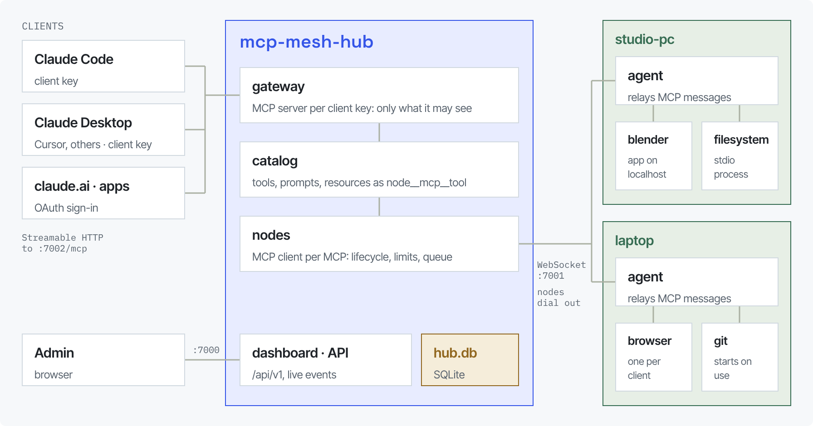
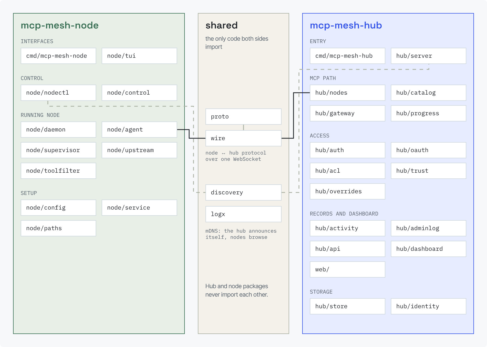
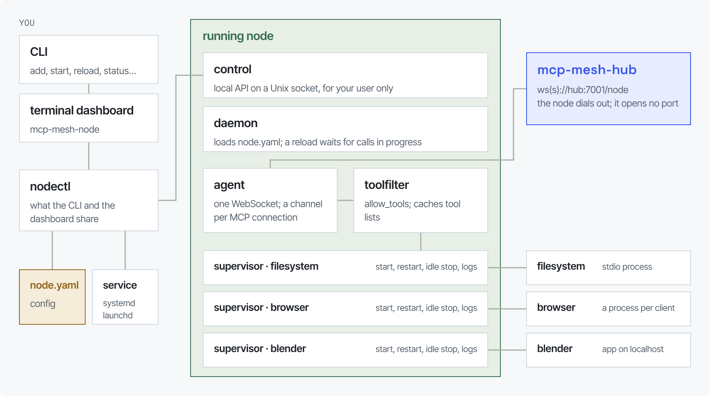
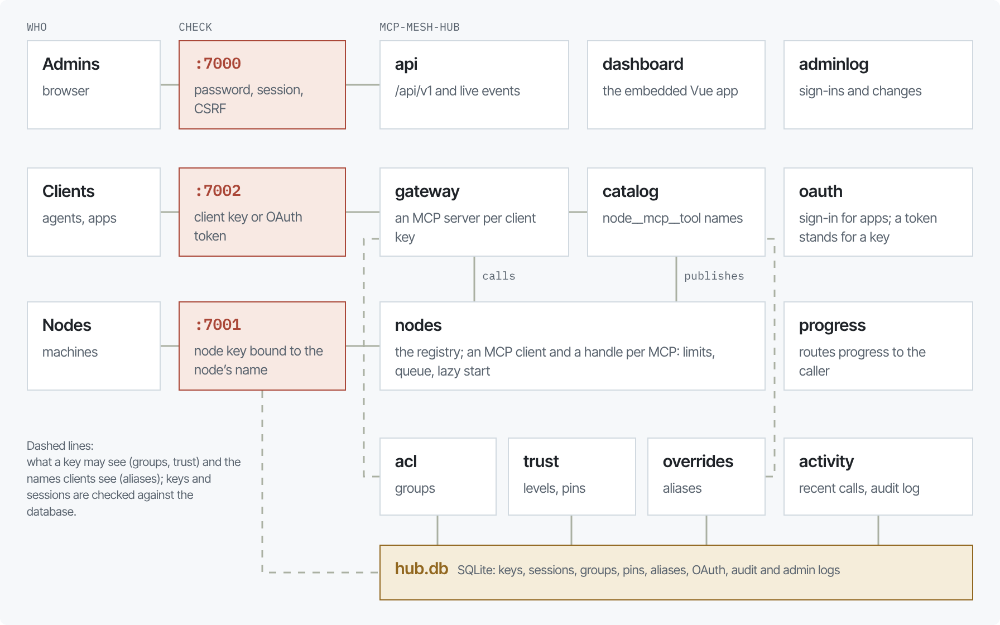
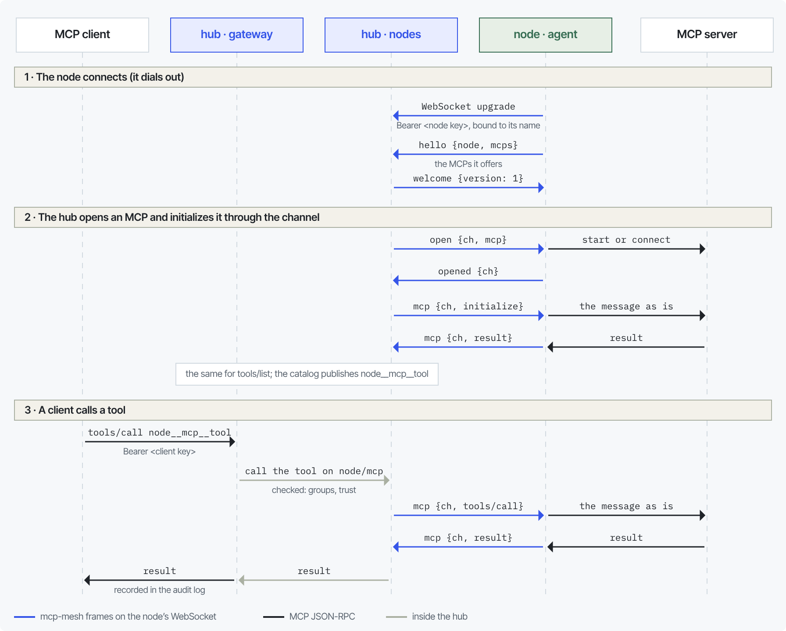
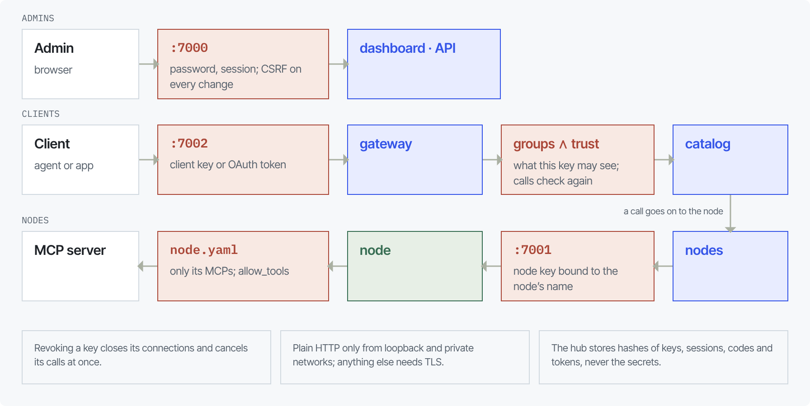

# Architecture

mcp-mesh has two programs. A **node** runs on each machine that has MCP
servers; the **hub** runs once. Every connection points toward the hub:
nodes dial out to it, clients connect to it, and no machine with MCP
servers opens a port.

The node is a relay. It launches MCP servers (or connects to ones an app
already runs) and copies their JSON-RPC messages to and from the hub
without interpreting them. The hub is a full MCP proxy: toward each MCP on
each node it is an MCP **client**, toward agents it is one MCP **server**,
and the catalog between the two merges every MCP's tools under one name
each. Because both sides are complete MCP sessions, each negotiates its own
protocol version.

## Modules

Hub and node packages never import each other; `proto`, `wire` and
`discovery` are the only shared code. Each side has one place where it is
assembled (`node/daemon`, `hub/server`); the commands in `cmd/` only turn
flags into their configuration.

| Package | Role |
| --- | --- |
| **Shared** | |
| `internal/proto` | the node ↔ hub envelope types and protocol version |
| `internal/wire` | envelopes over a WebSocket: framing, chunking, size limits, heartbeat |
| `internal/discovery` | mDNS: the hub announces itself, nodes browse |
| `internal/logx` | logging helpers |
| **Node** | |
| `cmd/mcp-mesh-node` | the CLI and the terminal dashboard's entry point |
| `internal/node/nodectl` | what the CLI and the dashboard share: inspect, start and stop, install, config edits |
| `internal/node/tui` | the terminal dashboard (Bubble Tea), a client of the control API |
| `internal/node/control` | the running node's local API on a Unix socket |
| `internal/node/daemon` | the running node: config, supervisors, the hub connection, the control API |
| `internal/node/agent` | the WebSocket to the hub: hello, channels, relaying, reconnects, pairing |
| `internal/node/supervisor` | one MCP's process: start, idle stop, crash backoff, logs |
| `internal/node/upstream` | the connection to one MCP: stdio, Streamable HTTP, HTTP+SSE |
| `internal/node/toolfilter` | `allow_tools`, and the tool lists the node caches |
| `internal/node/config` | `node.yaml`: loading, validation, edits that keep comments |
| `internal/node/service` | start at login or boot: systemd, launchd |
| `internal/node/paths` | where each platform keeps config, state and the socket |
| **Hub** | |
| `cmd/mcp-mesh-hub` | flags, and the key and admin commands |
| `internal/hub/server` | assembles everything behind the listeners |
| `internal/hub/nodes` | the node endpoint, the registry, each MCP's session and lifecycle |
| `internal/hub/pairing` | the pairing endpoint: nodes without a key waiting for an admin |
| `internal/hub/catalog` | every MCP's tools, prompts and resources under their exposed names |
| `internal/hub/gateway` | the MCP endpoint clients use (one MCP server per client key) |
| `internal/hub/progress` | routes progress notifications to the client that made the call |
| `internal/hub/auth` | keys, admin users, sessions, the TLS rule, trusted proxies |
| `internal/hub/oauth` | the OAuth authorization server for apps |
| `internal/hub/acl` | groups and grants |
| `internal/hub/trust` | node trust levels, tool pins and approvals |
| `internal/hub/overrides` | tool aliases and descriptions set by admins |
| `internal/hub/activity` | recent calls and the audit log |
| `internal/hub/adminlog` | the admin log |
| `internal/hub/api` | the JSON API under `/api/v1` and its live events ([API reference](api.md)) |
| `internal/hub/dashboard` | serves the embedded dashboard (`web/`) |
| `internal/hub/store` | the SQLite database and its migrations |
| `internal/hub/identity` | who is calling, carried in each request |
| `web/` | the dashboard: Vue 3, TypeScript, only `/api/v1` |

## Inside the node

The CLI and the terminal dashboard are thin clients of `nodectl`, so both
behave the same. The running node (the daemon) owns every MCP process and
serves a control API on a Unix socket readable only by its user; closing the
dashboard never stops an MCP. Each MCP has a supervisor that starts its
process when the hub opens a channel (at once for eager MCPs, on the first
call for lazy ones), restarts it after a crash with backoff, and stops it
after its idle timeout. The agent holds the single WebSocket to the hub.

The only MCP message the node reads is the tool list: it enforces
`allow_tools` there and caches the list, which it sends in `hello` so the
hub can show a lazy MCP's tools before it starts. The hub can open channels
only on MCPs the node offered; no message lets it choose a command.

## Inside the hub

For each MCP a node offers, the registry opens a channel, connects an MCP
client over it, lists what the MCP offers and publishes it in the catalog.
Each MCP has a handle that survives reconnects: it limits concurrent calls,
queues the rest, starts lazy MCPs on demand, and tells callers why an MCP
is unavailable. The catalog names everything from scratch on every change
(`<node>__<mcp>__<tool>`, admins' aliases first), and nothing a node sends
is trusted: malformed definitions are dropped and reported.

The gateway keeps one MCP server per client key, mirroring the catalog
filtered by what that key may see. The dashboard is a client of the JSON
API; the API reads the same state and pushes changes over server-sent
events.

## A call, frame by frame

The node ↔ hub protocol has six envelope types for a connected node, sent
as JSON over one WebSocket per node:

| Envelope | Direction | Carries |
| --- | --- | --- |
| `hello` | node → hub | the node's name, version and the MCPs it offers (with cached tool lists) |
| `welcome` | hub → node | the protocol version to use and the hub's message size limit |
| `open` | hub → node | open channel `ch` on MCP `mcp` (for a per-client MCP, for which client) |
| `opened` | node → hub | the channel is ready, or why it isn't |
| `mcp` | both | one JSON-RPC message on channel `ch` |
| `close` | both | channel `ch` is gone, and why (`idle`, `restart`, or a failure) |

A channel is one connection to one MCP: a process for a launched MCP, an
HTTP session for one an app serves. An envelope larger than 64 KiB is sent
as binary chunks that take turns with other channels' frames, so a large
result never holds up the node's other MCPs. Both ends ping every 20
seconds and close the connection after two missed answers.

A node without a key asks for one on a second endpoint, `/node/pair`,
which needs no credential and carries three more envelopes: `pair` (node
→ hub: the name it asks for, its host name and OS), `pairing` (hub → node:
a code the dashboard shows next to the request) and, once an admin
approves, `paired` (hub → node: a node key and the name it is bound to).
The connection stays open while the request waits; an admin who declines
closes it with code 4005. The node then saves the key and connects to
`/node` as usual.

## Who can do what

- **Each listener checks its own credential.** Nodes present a node key
  bound to their name; clients present a client key or an OAuth token;
  admins sign in with a password and every change they make carries a CSRF
  token. Plain HTTP is accepted only from loopback and private networks.
- **A node without a key gets one only from an admin.** Its pairing
  request only waits; an admin compares the code it shows with the one in
  the dashboard and approves it. Waiting requests are capped, in total and
  per address.
- **A client sees a tool only if its groups grant it and the node's trust
  level allows it.** Calls check again, so a hidden tool is never callable.
  A tool whose definition changed after approval is hidden until an admin
  approves the new one.
- **The machine decides what it shares.** The node offers only the MCPs in
  its `node.yaml`, and `allow_tools` limits a node's tools before the hub
  sees them.
- **Revocation is immediate.** Revoking a key closes the connections that
  used it and cancels their calls.

The hub stores only hashes of keys, sessions, codes and tokens.

## Limits

| Resource | Bound | Notes |
| --- | --- | --- |
| One MCP message | 32 MiB | on both ends of the WebSocket and in stdio framing; a result over the limit becomes an error, not a disconnect. A client's request to `/mcp` has the same limit |
| Concurrent calls per MCP | 8, then a queue of 32 | queue time counts toward the call timeout; past the queue a call fails at once as busy |
| One listing of an MCP | 1000 pages, 10,000 items, 16 MiB, 1 minute | tools, prompts, resources and templates together |
| Messages waiting for an MCP | 32 MiB per channel | an MCP that stops reading its input gets its channel closed |
| Output of an MCP nobody reads | 4096 messages or 64 MiB | |
| Session-based client sessions | 64 per key, closed after 30 minutes idle | |
| Stateless client requests and streams | 128 open per key | |
| Dead peer | about 50 s | a ping every 20 s, two missed pongs of 10 s each |
| Call duration | 2 minutes (`--call-timeout`) | MCPs can set their own; cancellation reaches the MCP |
| Partial chunked envelopes | 256 streams, 8 × the message limit | per connection |
| WebSockets per node | 1 | |

The hub is a single process by design, for one person or a small team (tens
of nodes, hundreds of MCPs). Live state is in memory; a restart drops client
sessions, nodes reconnect with backoff, and clients reconnect on their own.
