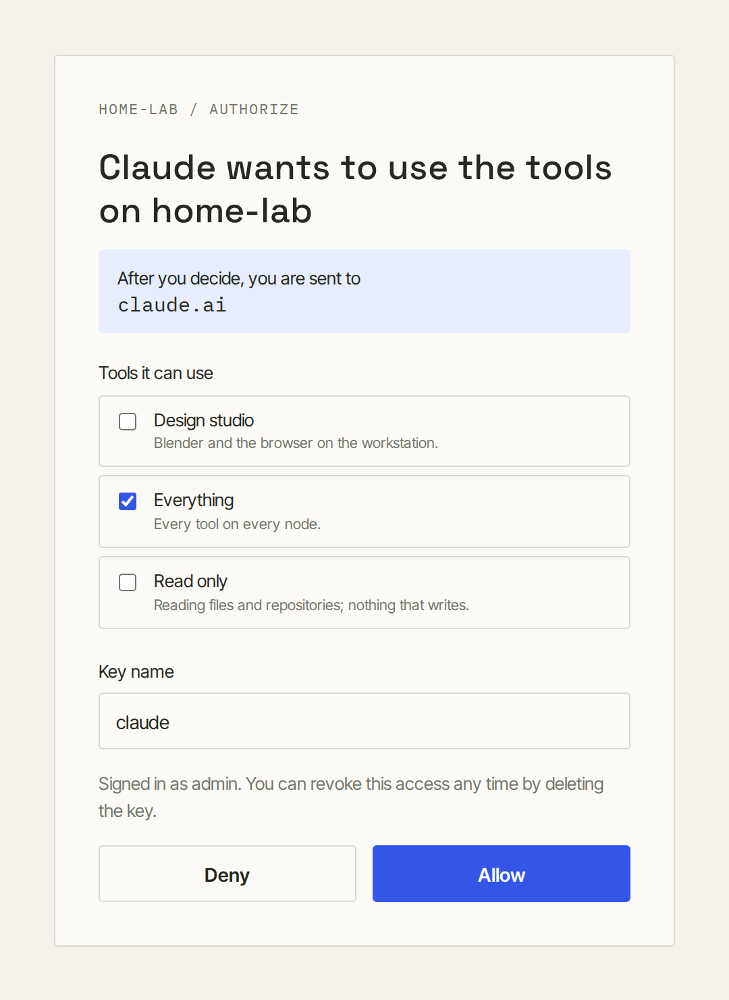

# Client setup

To an AI agent, the hub is one MCP server with every tool from every
machine. Clients connect over Streamable HTTP to `http://<hub>:7002/mcp`
(`https://` with TLS) with a client key as a bearer token, or sign in with
OAuth.

Create a client key in the dashboard (Keys → Create key → Client key) or
with the hub's [`key create client <label>`](hub.md#keys-and-admins). The
dashboard's **Connect** page has ready-to-paste setup for Claude Code,
Codex, OpenCode, Claude Desktop, Cursor and a curl test, and the new key's
dialog repeats it with the key filled in.

## Claude Code

```sh
claude mcp add --transport http mcp-mesh http://<hub>:7002/mcp \
  --header "Authorization: Bearer <client-key>"
```

## Codex

In `~/.codex/config.toml` (or `.codex/config.toml` in a trusted project):

```toml
[mcp_servers.mcp-mesh]
url = "http://<hub>:7002/mcp"
http_headers = { "Authorization" = "Bearer <client-key>" }
```

To keep the key out of the file, use `bearer_token_env_var = "MCPMESH_KEY"`
instead of `http_headers` and export `MCPMESH_KEY` before starting Codex.

## OpenCode

In `opencode.json` in your project, or `~/.config/opencode/opencode.json`:

```json
{
  "$schema": "https://opencode.ai/config.json",
  "mcp": {
    "mcp-mesh": {
      "type": "remote",
      "url": "http://<hub>:7002/mcp",
      "enabled": true,
      "headers": { "Authorization": "Bearer <client-key>" }
    }
  }
}
```

`"Bearer {env:MCPMESH_KEY}"` reads the key from the environment instead.

## Claude Desktop

`claude_desktop_config.json` launches local commands only, so a remote
server goes through the `mcp-remote` bridge (needs Node.js):

```json
{
  "mcpServers": {
    "mcp-mesh": {
      "command": "npx",
      "args": ["-y", "mcp-remote", "http://<hub>:7002/mcp", "--header", "Authorization:${MCPMESH_AUTH}"],
      "env": { "MCPMESH_AUTH": "Bearer <client-key>" }
    }
  }
}
```

## Cursor and other clients

Any client that takes a remote MCP URL and headers:

```json
{
  "mcpServers": {
    "mcp-mesh": {
      "url": "http://<hub>:7002/mcp",
      "headers": { "Authorization": "Bearer <client-key>" }
    }
  }
}
```

## Apps that sign in with OAuth

claude.ai, the Claude apps and other clients that add an MCP server by URL
need only the hub's URL. In Claude, open Customize → Connectors, add a
custom connector, and paste `https://<hub>/mcp`; on Team and Enterprise
plans an owner adds it for the organization first. The app opens the hub's
sign-in page, where an admin chooses which groups the app gets:

<p align="center">
  
</p>

This needs the hub at an HTTPS host name the app can reach; see
[Hub setup](hub.md#apps-that-sign-in-with-oauth). Claude connects to remote
MCP servers from Anthropic's cloud, so for claude.ai that name must be
reachable from the internet (a reverse proxy in front of port 7002 is
enough; the dashboard can stay private).

## What clients see

- **Tools** are named `<node>__<mcp>__<tool>`, so an agent knows where an
  action runs: `studio-pc__blender__render`. Admins can give a tool an alias
  or a different description in the dashboard.
- **Prompts** are named the same way. **Resources** keep their URI inside the
  hub's: `mcp-mesh://<node>/<mcp>/<original URI>`.
- A key sees only what its groups grant, and only tools the node's trust
  level allows. A tool it may not see doesn't exist for it.
- When tools appear or disappear (a machine connects, an MCP changes, an
  admin changes a group), clients that listen for list changes are told.
- Progress notifications reach the client that made the call. Calls end
  after the hub's call timeout (two minutes by default; MCPs can set their
  own), and cancelling a call stops it on the machine.

Both MCP protocol generations work: session-based clients (MCP 2025-11-25,
`Mcp-Session-Id`) and stateless ones (2026-07-28). The hub speaks to each
MCP server in the version that server supports.
