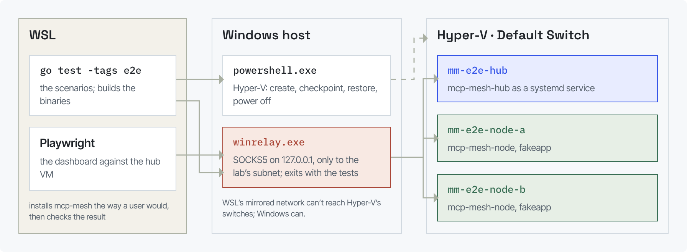

# End-to-end tests on VMs

These scenarios run the real binaries on separate machines: Hyper-V VMs on
the Windows host, driven from WSL. Each scenario restores the machines to a
clean checkpoint, installs mcp-mesh the way a user would, and checks what a
user would see. They complement `tools/livetest/livetest.sh` (one machine,
fast, run before every commit) with what only real machines show: power
loss, reboots, mDNS between machines, TLS with a private CA, a lossy
network, a backup restored on another machine, the dashboard in a real
browser against the hub VM.

| Scenario | What it shows |
| --- | --- |
| `TestTwoNodesMergeOverLAN` | two machines in one catalog; a CLI-made key sees its tools on its first request |
| `TestOAuthAppOverTLS` | a node over `wss://` with a private CA; an app signs in with OAuth (the Go SDK's client); denied consent |
| `TestFirstRunFromDashboardGuide` | a fresh machine set up by the dashboard's setup command alone |
| `TestMDNSDiscovery` | a node finds the hub on the LAN |
| `TestNodePowerLossMidCall` | the client learns within the heartbeat window; the node comes back after boot |
| `TestNodeRebootHeadless` | `install` explains start at boot; `install --at-boot` comes back with nobody logged in |
| `TestHubRestartAndCrash` | the node reconnects after a restart and a kill |
| `TestSlowUplinkBigResult` | 8 MB over 20 Mbit/s and 60 ms; a small call beside it |
| `TestBackupRestoreOnNewMachine` | the hub's data restored on another machine; the same keys work |
| `TestRevokedNodeKey` | the node is disconnected and says its key was rejected |
| `TestConfigChangeDuringCall` | adding an MCP to a running node only saves it; `reload` applies it after the call in progress |
| `TestDashboardAgainstHub` | Playwright (`web/e2e/hub`) against the hub VM through the relay |
| `TestWindowsHostNode` | the Windows host as a node (`wrap`, foreground) |

```sh
export MCPMESH_LAB_DIR=/mnt/d/mcp-mesh-vms
go test -tags e2e -timeout 60m ./e2e/                      # everything (about 5 minutes)
go test -tags e2e -timeout 20m -run TestOAuthAppOverTLS ./e2e/
KEEP=1 go test -tags e2e …                                  # leave the VMs running afterwards
```

The first run downloads Debian 12's cloud image (about 3 GB) and prepares
the machines (about 3 minutes). Later runs only restore checkpoints.

## Requirements (one time)

- Windows 11 Pro with Hyper-V, and the user in the **Hyper-V Administrators**
  group (no elevation is needed after that):

  ```powershell
  Enable-WindowsOptionalFeature -Online -FeatureName Microsoft-Hyper-V-All   # reboot
  Add-LocalGroupMember -Group "Hyper-V Administrators" -Member $env:USERNAME # sign out and in
  ```

- WSL2, and `MCPMESH_LAB_DIR` set to a folder on a Windows drive, as a WSL
  path (for example `/mnt/d/mcp-mesh-vms`): Hyper-V can't keep disks in the
  WSL file system. The lab needs a few GB there. Without it the suite is
  skipped.
- For `TestDashboardAgainstHub`: `npm --prefix web ci` and the browser's
  system libraries (`sudo npx playwright install-deps chromium`; on Ubuntu
  24.04 in WSL, `libasound2t64` is usually the only one missing). The suite builds the dashboard
  before the hub (`MCPMESH_E2E_SKIP_WEB=1` keeps `web/dist` as it is).

## How it fits together



- `hyperv/`: PowerShell from WSL (`-EncodedCommand`, JSON back): VMs,
  checkpoints, the raw-to-VHDX conversion, the cloud-init seed ISO (Windows'
  IMAPI2, so no ISO tools are needed).
- `lab/`: the machines. Base image, first boot with cloud-init, the `clean`
  checkpoint, SSH (x/crypto/ssh), and the relay.
- `winrelay/`: WSL's mirrored networking doesn't reach Hyper-V's internal
  switches, so connections to the VMs go through this small SOCKS5 relay
  that runs as a normal Windows process on loopback, only to the lab
  subnet, and exits when the tests do. A browser uses it as its proxy.
- `mesh/`: mcp-mesh on the machines: build and install the binaries, start
  the hub (optionally with TLS from a throwaway CA, addressed as
  `hub.e2e.test`), create keys with the hub's CLI, set up nodes with the
  documented commands, MCP clients through the relay.
- `oauthapp/`: a fake app that signs in with OAuth. It is the Go SDK's own
  OAuth client; a robot fills in the hub's sign-in and consent pages.
- `labctl/`: the same by hand: `go run ./e2e/labctl up|reset|status|ssh|run|down|destroy`.

Every VM's serial console goes to the named pipe `\\.\pipe\mm-e2e-<name>-com1`
(boot problems show there). When a scenario fails, the hub's journal, the
nodes' logs and `status --json` are saved in `e2e-results/<run>/<scenario>/`.

## Known issues

A scenario that hits a known, unfixed bug calls `knownIssue(t, id, …)`: it
logs `KNOWN ISSUE <id>` and goes on. When the bug is fixed the scenario
fails with "seems fixed", so the marker is removed and the check becomes a
plain assertion.
